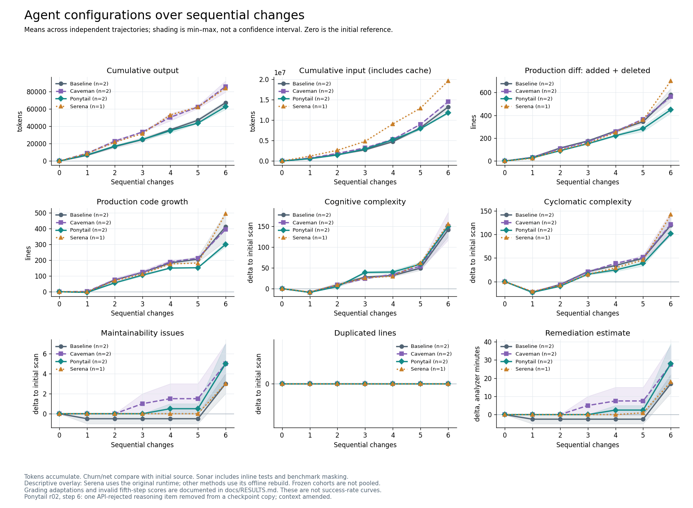

# AI Coding Agent Configuration Benchmarks

Independent, open-source research into how **model × skills × tools × agent configuration / workflow** affects software engineering performance. The central question is: **How much does agent configuration matter relative to model selection itself?**

This repository contains an implemented benchmarking harness, completed pilot experiments, source patches, normalized results, and analysis code. It is an experimental research framework, not a model leaderboard. Completed experiments hold the model fixed; they do not yet answer the question across models.

**Current evidence:** two separate single-task cohorts, followed by seven continuous trajectories with six sequential changes each. Baseline, Caveman, and Ponytail have two trajectories each; Serena has one. The seventh change is approved and in preparation, with **0/7 completed**. No new model runs are needed to inspect or redraw the published results.

> GitHub publication is pending authenticated repository creation. The clone URL below is the intended destination, not a verified live repository. See [publication checks](docs/PUBLICATION_CHECKS.md).

[Results](docs/RESULTS.md) · [Methodology](docs/METHODOLOGY.md) · [Reproducibility](docs/REPRODUCIBILITY.md) · [Live experiment register](EXPERIMENT_STATUS.md)

## Research questions

- Which skills, tools, and workflows improve task success, reliability, or efficiency?
- How sensitive are those effects to the model and reasoning configuration?
- Do quality improvements justify additional tokens, runtime, and API expenditure?
- How do code changes and regressions accumulate during a sequence of tasks?
- Which observations survive independent repetitions and different repositories?

The framework is intended to support new configurations. Current evidence covers baseline, planning variants, Ponytail, Caveman, and Serena. Kimi, ECC, other models, and combinations are possible research directions, **not completed comparisons**.

## Methodology

The harness adapts pinned [SWE-Milestone](https://github.com/DeepCommit-ai/SWE-Milestone) integration for isolated Codex profiles and ChatGPT OAuth. Initial experiments use real Rust tasks in ripgrep. Each independent trajectory starts from a fixed source tree and isolated agent state. Sequential tasks retain its source changes and session; Serena memories persist within a trajectory and never transfer between repetitions.

Inputs record model, reasoning effort, CLI version, task order, runtime images, prompts, skill assets, activation evidence, and source hashes. Agent integration is separate from the benchmark evaluator and protected quarantine. Static analysis occurs after submission and is not model feedback. Historical frozen cohorts remain separate; recovery and grader adaptations are disclosed in their protocols.

Main curves average independent repetitions at the same task step. Bands show **min–max, not confidence intervals**. Sequential steps are dependent observations. Missing metrics remain missing; failures remain in the experiment record.

## Agent configurations

Completed experiments use **`gpt-6.1-sol`, high reasoning effort, Codex CLI 0.163.0**, authenticated through ChatGPT OAuth.

| Configuration | Intervention | Evidence status |
| --- | --- | --- |
| Baseline | Clean profile; no experimental hooks, MCP, or inherited memories | Matched reference within each cohort |
| Plan / goal + plan | Separate preparation session and executor handoff | Historical single-task cohort; excluded from current runs |
| Ponytail | Pinned 5.3.2/full skill and native hooks | Activation audited; two six-step trajectories |
| Caveman | Pinned v4.0.1 skill and native hooks | Activation audited; two six-step trajectories |
| Serena | Pinned 1.6.1 MCP tools and trajectory-local memories | One six-step trajectory; actual calls verified |

Serena's historical single-task run made **zero measured MCP calls**, despite successful startup. Later continuous runs test an explicit Serena-first policy and do use its tools. These are different conditions. The combined display preserves runtime provenance: Serena uses the original runtime, while the other current methods use its offline rebuild. See [run parameters](reports/plots/run_parameters.md).

## Evaluation metrics

| Metric | Implementation and interpretation |
| --- | --- |
| Task resolution | Raw grader decisions, test counts, and grading validity; infrastructure failures distinguished from task failures |
| Tokens | Input, cached input, uncached input, output; session deltas prevent repeated counting |
| Execution time | Measured model invocation time; excludes setup, grading, static analysis, and pauses |
| Source footprint | Added/deleted production lines, net growth, churn, and changed files; pinned AST filter excludes Rust inline tests |
| Static code quality | Snapshot-bound SonarQube complexity, cognitive complexity, duplication, maintainability issues, and remediation estimates |
| Tool and memory usage | Actual MCP/semantic calls, activation evidence, memory counts, and retention checks |
| API cost | **Not measured in the current OAuth experiments**; no dollar savings inferred from subscription usage |
| Readability / human review effort | Patch surface and static metrics are proxies; no direct human study performed |

SonarQube includes inline tests and benchmark masking. Its deltas are not production-only quality measurements. Remediation minutes are analyzer estimates, not measured human review time.

## Experiments and results

The first single-task experiment has two matched cohorts. Each configuration has one observation; the baselines belong to different environments and must not be pooled.

| Cohort | Configuration | Grader resolved | Output tokens | Production churn |
| --- | --- | --- | ---: | ---: |
| Planning | Baseline | true | 9,125 | 108 |
| Planning | Plan | true | 14,022 | 111 |
| Planning | Goal + plan | true | 20,023 | 117 |
| Skills | Baseline | true | 10,294 | 102 |
| Skills | Ponytail | true | 10,092 | 92 |
| Skills | Caveman | true | 13,205 | 98 |
| Skills | Serena | true | 9,732 | 102 |

All seven measured trials resolved the task. Planning used more output tokens on this task. The skill cohort shows small footprint differences, but Serena's zero tool usage prevents attributing its outcome to MCP. These are pilot observations, not evidence of general superiority. [Original report](reports/pilot_report.md).

The later continuous experiment measures how changes accumulate:



| Configuration | Independent trajectories | Cumulative output, mean | Production churn to initial source, mean | Sonar cognitive complexity Δ, mean |
| --- | ---: | ---: | ---: | ---: |
| Baseline | 2 | 67,311.5 | 578.5 | 142 |
| Caveman | 2 | 85,989.5 | 561.5 | 150.5 |
| Ponytail | 2 | 62,766 | 449 | 150.5 |
| Serena | 1 | 84,165 | 701 | 156 |

Ponytail has 6.8% lower mean output and 22.4% lower mean production churn than baseline in this small sample. This does **not** establish better quality or statistical significance. All seven sixth-step graders are valid and return **`resolved=false`**, with 7/8 new tests passing. Fifth-step test scores remain invalid because of a documented grader compatibility failure.

Ponytail repetition 2 includes one explicitly authorized removal of an API-rejected encrypted reasoning item from a checkpoint copy at step 6. Source, session identity, and earlier submissions are retained; reasoning history is not an unchanged continuation. The figure and reports disclose this deviation.

[Detailed results](docs/RESULTS.md) explain grading caveats, recovery attempts, and the lack of a statistical winner. [Tracked plot data](reports/plots/current_comparison.json) contain means, counts, ranges, and provenance. Historical reports describe their original stage and may contain superseded plans.

## Getting started

For public analysis, use Linux, Git, and Python 3.12 or newer. Recorded benchmark Python is 3.13.14; another runtime does not recreate the frozen experiment environment.

```bash
git clone https://github.com/DemidovArtem/ai-coding-benchmarks.git
cd ai-coding-benchmarks
python3 -m venv .venv
.venv/bin/python -m pip install -r requirements-setup.txt -r requirements-plots.txt
.venv/bin/python docs/render_results.py
```

The renderer reads tracked JSON only and writes PNG/SVG under `docs/figures/`. It makes no model requests and does not refresh experiment records. Docker, Codex authentication, and private artifacts are not needed to redraw the figure. The full test suite additionally requires the pinned public SWE-Milestone checkout and temporary loopback sockets; see [local checks](docs/REPRODUCIBILITY.md#local-test-suite).

**New benchmark trials require separate setup:** pinned upstream checkout and dataset, Docker images, recorded Codex/Node/Rust toolchain, isolated OAuth profiles, and live quota/storage/network checks. Existing runners reject paid API-key environments. They are research scripts with retained local paths, not a portable one-command service. [Reproducibility](docs/REPRODUCIBILITY.md) distinguishes clean-clone analysis from execution requiring retained artifacts. Do not invoke historical phase modules simply to inspect results.

## Repository layout

- `experiment/`: orchestration, profile checks, collection, grading provenance, analysis.
- `profiles/`, `prompts/`, `patches/`: pinned assets, instructions, upstream integration patch.
- `sonar/`: pinned local SonarQube deployment and analysis documentation.
- `reports/`: normalized results, frozen protocols, plots, source patches.
- `docs/`: current English methodology, results, and reproducibility instructions.
- `tests/`: local harness checks; no model inference.
- `results/`, `vendor/`: ignored runtime artifacts and upstream checkouts.

## Development and acknowledgements

The benchmarking harness was developed entirely using **OpenAI Codex**, under the direction of **Artem Demidov**. Research design, experimental methodology, and results interpretation are independently managed by the project maintainer. Codex is a development tool, not a separate human collaborator.

The project builds on SWE-Milestone, ripgrep, SonarQube, and the evaluated skills/tools. Inclusion does not imply endorsement. [Third-party notices](THIRD_PARTY_NOTICES.md) preserve their licenses. New Codex-assisted commits use an explicit co-author trailer; existing commit authors and dates are preserved.

## Roadmap

- Improve portable environment reconstruction and publish reproducibility checks.
- Complete approved continuations while preserving checkpoints and failures.
- Add independent repetitions and repositories before making general claims.
- Compare models and configuration interactions under matched conditions.
- Explore more skills, tools, and workflows without fixing the framework to today's list.
- Add API cost accounting for a separately defined API-funded cohort.
- Investigate direct readability, maintainability, and human review measurements.

No promised deadlines or fixed task-count ladder. New scopes need a protocol and resource budget.

## License

Original project code and documentation use the [MIT License](LICENSE). Third-party assets and upstream patch context retain their own licenses, including Apache-2.0 for pinned Caveman assets. See [THIRD_PARTY_NOTICES.md](THIRD_PARTY_NOTICES.md).
