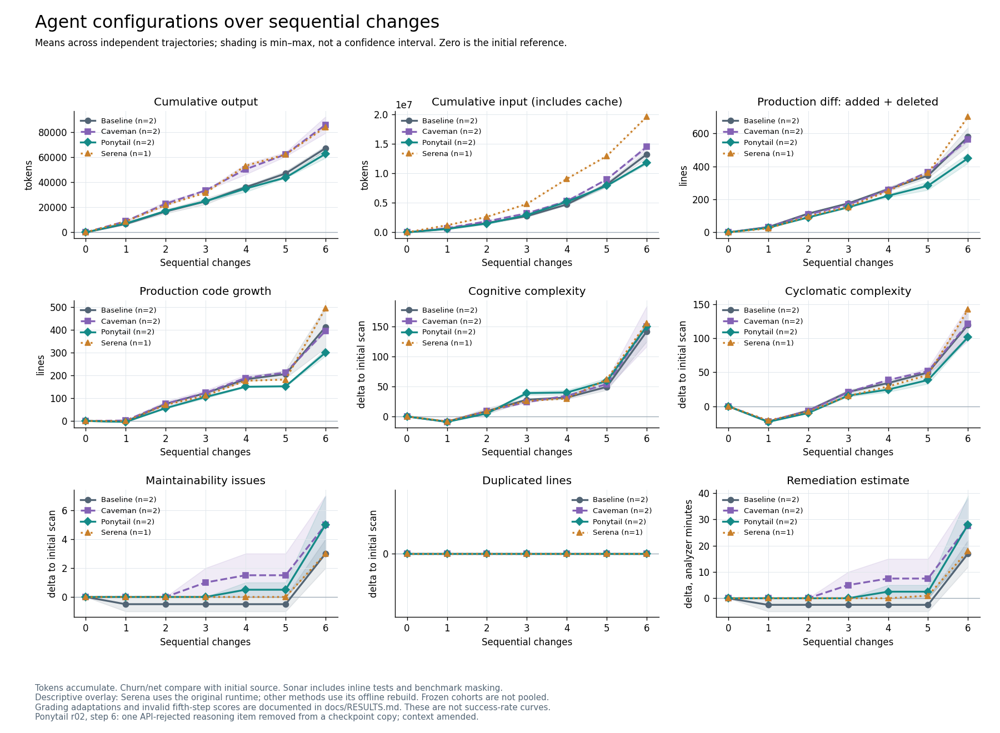

# Results

Status: **5 November 2026**. Exploratory measurements from one ripgrep task chain. These results do not establish a statistically significant winner. Definitions and comparison boundaries are in [methodology](METHODOLOGY.md).

## Continuous experiment: six completed edits

Baseline, Caveman, and Ponytail each have two independent six-step trajectories; Serena has one. This yields 42 completed step submissions and 24 method-by-step mean points. The seventh JSON replacement task is approved and preparing: **0/7** continuations collected. There are no seventh-step metrics yet.

The following values are measured after six edits. Each cell gives the mean, followed by the observed min–max across repetitions. A single Serena observation has no estimated between-run spread.

| Approach | Independent trajectories | Cumulative output tokens | Production churn from start | Cognitive complexity delta |
| --- | ---: | ---: | ---: | ---: |
| Baseline | 2 | 67,311.5 (65,442–69,181) | 578.5 (522–635) | 142 (125–159) |
| Caveman | 2 | 85,989.5 (79,459–92,520) | 561.5 (551–572) | 150.5 (117–184) |
| Ponytail | 2 | 62,766 (59,521–66,011) | 449 (420–478) | 150.5 (149–152) |
| Serena | 1 | 84,165 | 701 | 156 |

Relative to the displayed baseline mean, Ponytail has 6.8% fewer output tokens and 22.4% less production churn. Caveman has 27.7% more output tokens and 2.9% less churn. These are descriptive differences in this sample, not evidence of superior correctness, maintainability, or general token savings. Sonar cognitive deltas do not favor a consistent quality winner.

All seven sixth-step graders completed valid evaluations. Each passed **7/8 new tests**, but all seven have **raw resolved=false**. Retained pass-to-pass counts are 1,085–1,086 of 1,089. Earlier fifth-step scores remain invalid because of an undeclared max_matches dependency; they are not measured zero scores and are not repaired retrospectively by step 6.

Serena made **71 successful MCP calls** during step 6, including **24 semantic calls**. Its memory inventory grew from **12 to 13 files**, with a retained-memory read verified. This confirms functioning tool use and continuity in this trajectory; it does not establish an effectiveness advantage.

Ponytail repetition 2 includes an authorized step-6 context amendment: one API-rejected encrypted reasoning record was removed from a checkpoint copy. Its source, session, prior submissions, and remaining history were preserved. The point remains in the descriptive mean and is explicitly annotated. Quota stops and other recoveries do not count as new independent repetitions.

Sources: [sixth-step findings](../reports/phase6f_findings.md), [completion audit](../reports/phase6f_completion_audit.json), [numeric plot data](../reports/plots/current_comparison.json), [run parameters](../reports/plots/run_parameters.md), [seventh-step status](../reports/phase6g_progress.md).

## Initial isolated pilot

This earlier pilot used one task, `maintenance_fixes_1_sub-01`, without repetitions. Phase 2 compared planning workflows; Phase 3 compared skills in a different runtime. Each has its own baseline. These rows are historical observations and are not pooled with the continuous experiment.

| Frozen cohort | Approach | Resolved | Production churn | Total output tokens |
| --- | --- | --- | ---: | ---: |
| Phase 2: planning | Baseline | true | 108 | 9,125 |
| Phase 2: planning | Plan | true | 111 | 14,022 |
| Phase 2: planning | Goal + plan | true | 117 | 20,023 |
| Phase 3: skills | Baseline | true | 102 | 10,294 |
| Phase 3: skills | Ponytail | true | 92 | 10,092 |
| Phase 3: skills | Caveman | true | 98 | 13,205 |
| Phase 3: skills | Serena | true | 102 | 9,732 |

All seven measured isolated trials passed the upstream scoring requirements: fail-to-pass 2/2, pass-to-pass 1,093/1,093, and none-to-pass 2/2. Raw suites still contain 15 failures and one skip; raw suite totals and the benchmark's acceptance criterion are distinct. The separate initial smoke was also accepted.

On this task, planning increased output and churn without changing acceptance. Ponytail and Caveman had slightly smaller churn than their matched skill baseline. With n=1 per approach, none of these differences establishes a general effect. Historical Serena had confirmed server activation but **zero measured MCP calls and zero memories**; that trial did not measure semantic-tool or memory benefits. Later continuous Serena use is a separate result.

Source: [original pilot report](../reports/pilot_report.md), including exact versions, source pins, and cohort boundaries.

## Interpretation limits and next work

- The seven trajectories share one repository and task chain; their successive edits are dependent observations. Six edits do not provide six independent repetitions.
- The figure overlays original Serena and offline-runtime cohorts while retaining each cohort's means. It does not create cross-cohort paired baseline comparisons.
- Bands show observed min–max, not confidence intervals. Serena n=1 has no between-run uncertainty estimate. No significance tests are reported.
- Sonar includes inline tests and benchmark masking. Its static metrics and remediation estimates do not directly measure production-only quality or human review effort.
- Step 3 includes a regex serialization mismatch; step 4 changes the residue-pruning protocol and retains other unexplained failures; step 5 has invalid grading. These caveats prevent treating every raw rejection as accumulated agent error.

The current priority is publication and a separate [scikit-learn cohort](SECOND_REPOSITORY.md), authorized on 5 November 2026. The seventh ripgrep continuation remains prepared and unexecuted; its earlier authorization is retained. Broader conclusions need more independent trajectories, a predefined primary metric and effect size, and additional repositories or task chains. The [live experiment register](../EXPERIMENT_STATUS.md) is the authoritative status entry point.
