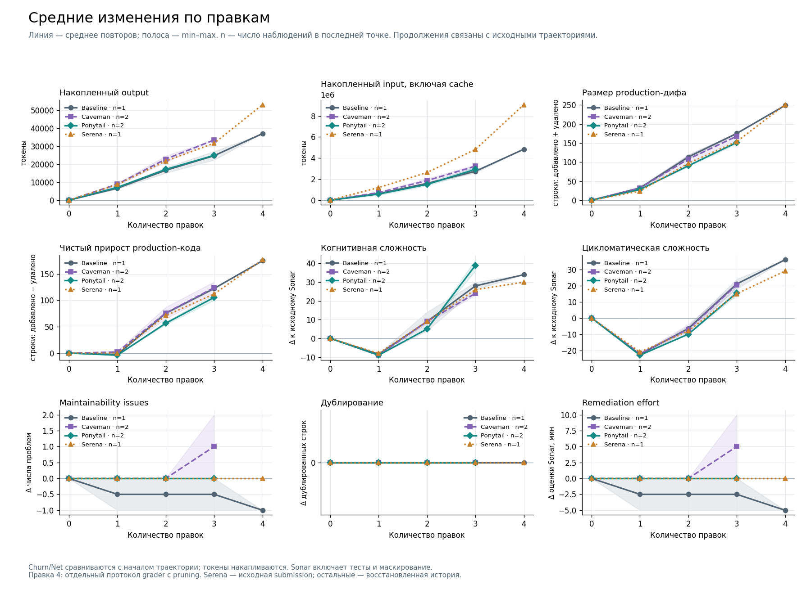
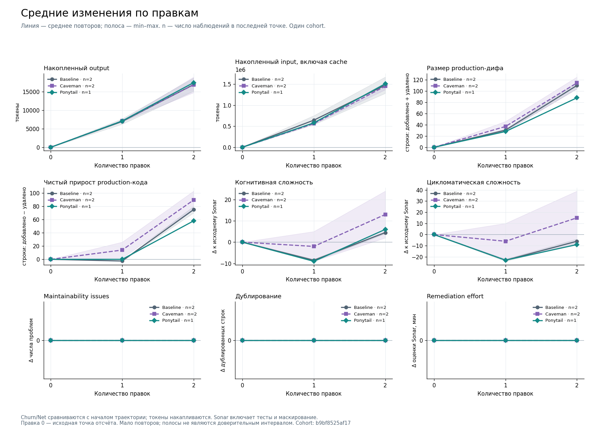
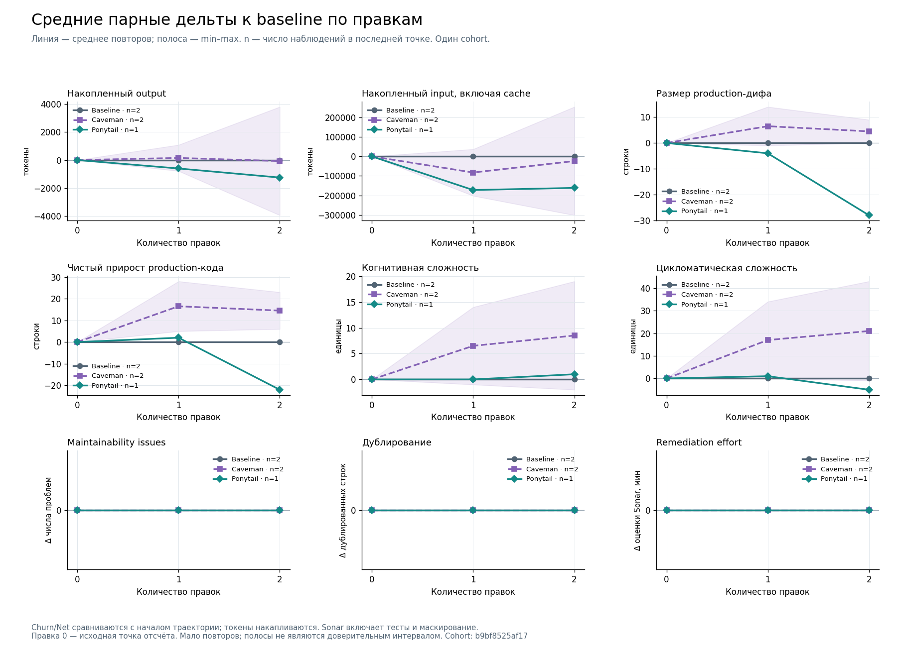

# Основные графики: среднее по повторам

**Основной график объединяет baseline, Caveman, Ponytail и Serena по одинаковой последовательности задач; готовые продолжения добавляют четвёртую точку.** Число правок по X общее. Внутри каждой линии сохраняется среднее её независимых повторов, min/max и n. Незавершённый шаг и отсутствующий подход не получают нулей. Новые повторы обновляют ту же линию.



Первые три точки Serena используют сохранённые шаги Phase 6; baseline/Caveman/Ponytail — Phase 6c. Четвёртые точки Phase 6d связаны с конкретными исходными траекториями и не увеличивают число независимых повторов. Пока четвёртый шаг готов только для части повторов, его n может отличаться от третьего шага. Model, effort, CLI 0.163.0, исходное дерево, первые три SRS, grading mode и quarantine совпадают. У новых runs другой runtime image ID: в образ заранее добавлен тот же standalone Codex, чтобы избежать неработающего installer URL. Различие указано на рисунке и в [точных параметрах](run_parameters.md).

Это общий визуальный вид. Значения и средние исходных групп не пересчитываются вместе. [current_comparison.json](current_comparison.json) хранит отображённые точки и источник каждой линии; [mean_data.json](mean_data.json) сохраняет все исходные наблюдения. Парные baseline deltas сохраняются в рамках исходных групп, где есть соответствующий baseline. Этот рисунок сам не создаёт пар для Serena из другой группы.

[Живой реестр](../../EXPERIMENT_STATUS.md) · [PNG](mean_curves_current.png) · [SVG](mean_curves_current.svg) · [PDF, общий вид на первой странице](mean_comparison.pdf). Продолжения выполняются по [протоколу Phase 6d](../phase6d_protocol.md). Для Serena переоценена уже сохранённая четвёртая submission; её исходные токены и Sonar используются один раз, без нового inference. Четвёртый grader одинаково включает source-residue pruning для всех подходов; первые три raw scores не переписаны. Поэтому это продолжение с явно изменённым четвёртым grading protocol, а не новый повтор первых трёх задач.

## Исторический двухшаговый cohort



Три линии показывают baseline, Caveman и Ponytail. По оси X — количество последовательных правок. В каждой точке берётся арифметическое среднее всех завершённых повторов **с теми же условиями и той же последовательностью задач**. Следующий повтор добавляет наблюдение к этому среднему. Отдельных линий «запуск 1» и «запуск 2» в основном отчёте нет.

Полоса — минимум и максимум наблюдений; это не доверительный интервал. `n` — число измеренных повторов. Если нового повтора нет, он не добавляет ноль. В текущем срезе baseline и Caveman имеют по два повтора, Ponytail — один. Поэтому у Ponytail ещё нельзя оценить разброс.

Токены накапливаются по шагам. Input включает cached input. Production churn и net уже считаются относительно исходного commit и не складываются между шагами. Sonar показан как изменение относительно общей исходной базы. В эти Sonar deltas входят различающийся inline test-код и начальное маскирование benchmark tests: отрицательная сложность не доказывает улучшение production-кода. Нулевая правка — исходная точка отсчёта, не дополнительный модельный запуск.

## Парные дельты



Для каждой пары сначала вычисляется `подход − baseline` того же повтора, а затем усредняются дельты имеющихся пар. Такой расчёт не подменяет отсутствующий второй Ponytail повтор средним baseline по двум повторам. У baseline парная дельта равна нулю по определению.

## Что сохраняется

- [PDF по всем отдельным cohorts](mean_comparison.pdf), PNG и SVG.
- [mean_data.json](mean_data.json): отдельные наблюдения, среднее, min/max, стандартное отклонение и `n` для каждой метрики.
- [run_parameters.md](run_parameters.md), [run_parameters.json](run_parameters.json): условия каждого запуска и технические паузы. Изменение model, effort, runtime, prompts, tasks или quarantine создаёт другую группу сравнения.
- [Патчи и replay manifest](../patches/README.md): исходные textual diffs и точные Git bindings. Они не заменяют историю сессии и сами не реализуют продолжение эксперимента.

Числа обновляются из canonical records командой ниже. Из tracked `mean_data.json` графики воспроизводятся той же командой без `--refresh-data`. Нужен Matplotlib; новые benchmark runs команда не запускает.

```bash
python reports/plots/mean_curves.py --refresh-data
```

Plan и goal_plan исключены из новых экспериментов и основных средних кривых. Их исторические результаты и прежние графики сохранены. Phase 2/3, исходный Phase 5 и новая registry policy не объединяются. У нового Phase 5b пока нет завершённых измерений, поэтому он не добавляет точек в графики.

Новый benchmark запускается только по явной отмашке пользователя. [Актуальный реестр](../../EXPERIMENT_STATUS.md). Короткие цепочки и мало повторов не подтверждают долгосрочное накопление ошибок; кривые показывают только измеренные изменения.

Phase 6: у третьего Serena шага raw grader и task-local filtered grader расходятся из-за проверки порядка веток эквивалентного regex. Canonical raw score сохранён; интерпретировать его как ухудшение поведения без дополнительного анализа нельзя. [Доказательства совместимости grader](../phase6_grader_compatibility.json), [текущие результаты Phase 6](../phase6_progress.md).

Phase 6c: baseline на третьем шаге воспроизвёл тот же `re35` mismatch; canonical raw score не изменён. [Наблюдения и SHA исходных grader records](../phase6c_grader_observations.json).
