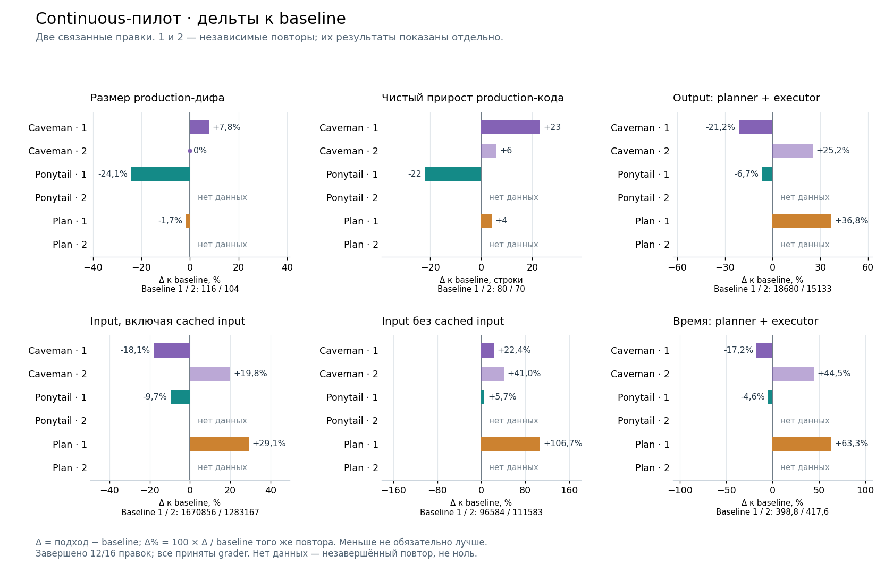
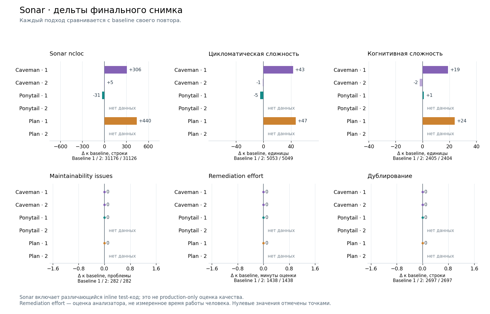
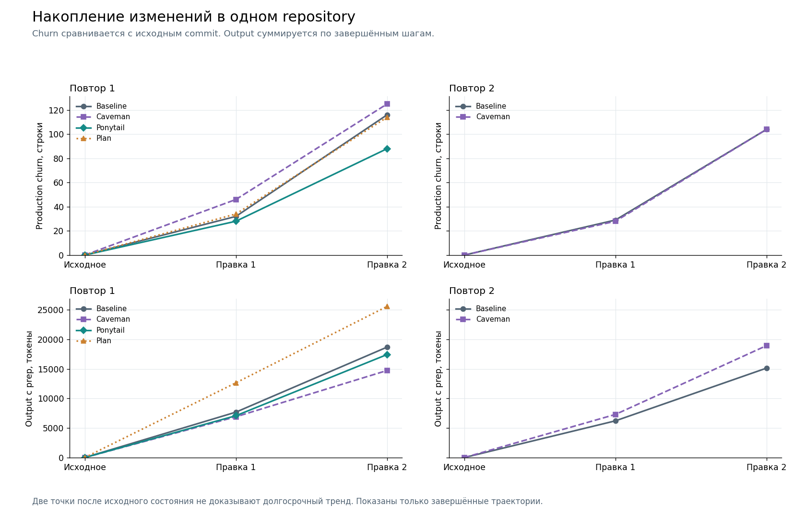
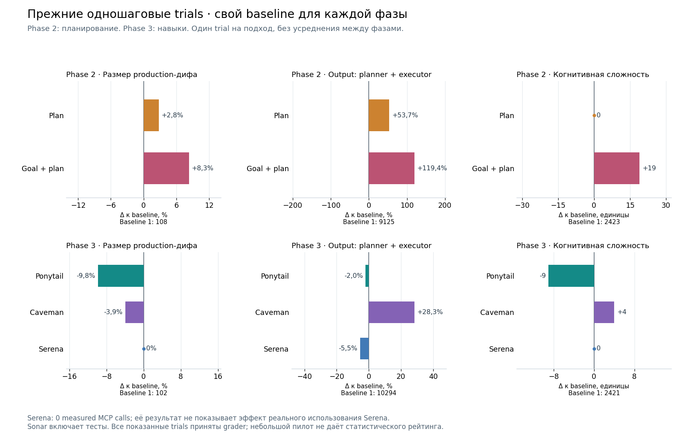

# Графики сравнения подходов

Срез после остановки Phase 5 на quarantine preflight: 12 из 16 правок завершены и приняты grader. Baseline и Caveman имеют по два полных повтора; Ponytail и plan — по одному. Незавершённые повторы не заменяются нулями. [Актуальный реестр](../../EXPERIMENT_STATUS.md).

## Continuous: размер дифа, токены и время



Все дельты рассчитаны к baseline **того же повтора и frozen cohort**. Абсолютная дельта — `подход − baseline`; процентная — `100 × (подход − baseline) / baseline`. Отрицательное значение означает меньшее измеренное значение, но не само по себе лучшее качество. Повторы показаны отдельно; среднее по несбалансированной выборке не рассчитывается.

Production churn — добавленные плюс удалённые строки production-кода в финальном snapshot относительно начала траектории. Net — добавленные минус удалённые строки. Тесты исключены; cumulative churn двух шагов не складывается. Output и input включают planner + executor за оба шага. Input уже содержит cached input; это не два складываемых расхода. Input без cache — их разность. Токены не переводятся в стоимость подписки или точную стоимость квоты.

Время включает только измеренные planner + executor invocations. Setup, grader, Sonar и паузы между запусками исключены. Это описательное время, а не доказательство одинаковой нагрузки или производительности сервиса.

Наблюдения этого среза:

- Ponytail, повтор 1: production churn −24,1%, output −6,7% к baseline. Второго повтора нет.
- Caveman: output −21,2% в повторе 1, но +25,2% в повторе 2; устойчивое преимущество не подтверждено.
- Plan, повтор 1: production churn −1,7%, output +36,8%, время planner + executor +63,3%. Второго повтора нет.

## Sonar



Сравниваются финальные снимки с baseline своего повтора. Во всех завершённых continuous траекториях maintainability issues, remediation effort и duplicated lines совпадают с baseline. Ноль отмечен точкой; отсутствие наблюдения подписано отдельно.

Sonar включает различающийся inline test-код. Его aggregate deltas не являются production-only оценкой качества. Remediation effort — оценка анализатора в минутах, а не измеренное время человеческого review.

## Накопление по двум правкам



Для каждого повтора показаны cumulative production churn и накопленный output. По строкам графиков общая шкала Y. Для churn каждая точка сравнивается с исходным commit; output складывается из per-step counters, уже отделённых от cumulative session counters. Отрезки соединяют наблюдения, а не предсказывают поведение между ними. Две правки не доказывают долгосрочное накопление технического долга.

## Прежние одношаговые эксперименты



Phase 2 и Phase 3 сравниваются только со своими baseline. Ни между ними, ни с Phase 5 значения не усредняются. Это по одному наблюдению на подход. Serena имеет 0 measured MCP calls: результат не измеряет эффект её реального применения. Grader acceptance не означает отсутствие всех failures в raw suite.

## Данные и воспроизведение

[Общий PDF, четыре страницы](comparison.pdf), [снимок данных](data.json), [генератор](generate.py). Каждая иллюстрация также сохранена в SVG рядом с PNG.

Генератор использует Matplotlib; текущий рендер выполнен с версией 3.10.5 из локального cache, без загрузки пакетов и изменения benchmark runtime. Для воспроизведения достаточно Python с Matplotlib и tracked `data.json`:

```bash
python reports/plots/generate.py
```

Обновление снимка после новых результатов читает локальный canonical JSONL и `reports/phase5_comparison.json`:

```bash
python reports/plots/generate.py --refresh-data
```

В `data.json` сохранены SHA-256 исходного JSONL, идентификаторы trials и только поля для сравнения; credentials и raw traces не включены. Генератор проверяет уникальность IDs, принятие grader, отсутствие collection errors, успешный Sonar, идентичность paired keys и session continuity двух шагов. Графики не запускают модели и не меняют canonical register.

Quarantine preflight позднее обнаружил доступность запрещённого registry. Предыдущие preflight проверки прошли, но не доказывают его непрерывную изоляцию во время всех запусков. [Диагностика и ограничение результатов](../phase5_quarantine_failure.md). Малый незавершённый пилот не даёт статистического рейтинга подходов.
